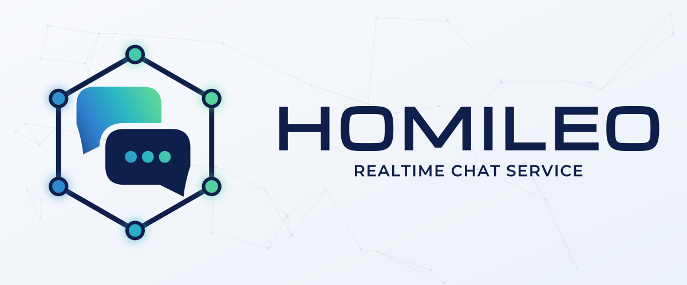

<p align="center">
  
</p>

# Homileo

**ὁμιλέω** — *to converse, to talk together.*

A generic chat service for apps built on [tereo](https://github.com/tereo-io/tereo). Homileo owns
the hard parts of chat — spaces, sessions, messages, threads, reactions, mentions, read state,
attachments, presence, search, realtime delivery and catch-up — so an app can extend it with its
own data instead of rebuilding them.

It ships three things: an **API** that apps extend (their own space kinds, metadata, message types,
bots and webhook events), a **standalone UI**, and **React components** for apps to import and
customise. It is deployed once per app, beside that app's tereo.

The design is in [docs/superpowers/specs/2026-10-30-homileo-design.md](docs/superpowers/specs/2026-10-30-homileo-design.md).
Conventions for contributors and for Claude Code are in [CONTRIBUTING.md](CONTRIBUTING.md) and
[CLAUDE.md](CLAUDE.md).

## Packages

| Path | Contents |
|------|----------|
| `packages/homileo` | The service: Express REST API under `/v1`, socket.io on `/ws`, Prisma + Postgres, `ROLE` = `all` / `api` / `worker` |
| `packages/homileo-sdk` | `@homileo-io/sdk`: the event registry and provisioning document types (client in plan 5) |
| `packages/homileo-react` | `@homileo-io/react` (plan 6) |
| `packages/homileo-ui` | Standalone app (plan 7) |

## Develop

```sh
npm install
docker compose up -d postgres redis                      # host ports 5452 / 6399
cp packages/homileo/.env.example packages/homileo/.env
cd packages/homileo
npx prisma generate && npx prisma migrate deploy
npm run dev                                              # http://localhost:4101
```

Run the checks CI runs before pushing:

```sh
npm run format && npm run sort-imports && npm run lint && npm run check
```

## Current state

Homileo is built in seven plans (design spec, *Architecture*):

| # | Plan | State |
|---|------|-------|
| 1 | Foundation — monorepo, service skeleton, principals and organizations, provisioning, the write path (`recordChange`), the access policy, Docker and CI | **In progress** |
| 2 | Core chat API — spaces, sessions, messages, threads, reactions, read state, OpenAPI | Not started |
| 3 | Realtime and sync — socket.io, `GET /v1/sync`, event retention | Not started |
| 4 | Search — Postgres full-text and trigram search | Not started |
| 5 | SDK and event contract — typed client, AsyncAPI | Not started |
| 6 | React components | Not started |
| 7 | Standalone UI and release | Not started |

Plans 2–4 are server work; 5–7 wait until the server is done.
